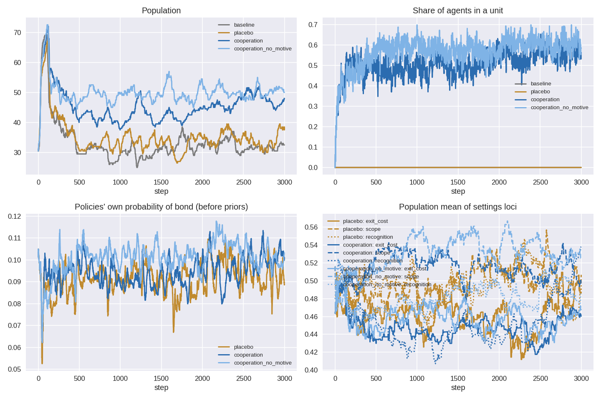

The spatial cooperation experiment asks whether an institution evolves when
agents choose it with their own learned policies. In the
[intrinsic-evolution world](../experiments/intrinsic_evolution/intrinsic_evolution.md),
`bond` and `leave` are two more actions for the same brain that decides
whether to gather or attack, and the terms a unit offers are heritable loci.
The design is registered in [SpatialDesign.md](../experiments/cooperation/SpatialDesign.md):
four arms (`baseline`, `placebo`, `cooperation`, `cooperation_no_motive`),
seeds 101–120, 3,000 steps, and a Holm family of seven seed-paired tests.
This post covers the work done to make the confirmatory run launchable, from
the readiness review of
[PR #1020](https://github.com/Dooders/AgentFarm/pull/1020) to the pilots
that followed. The confirmatory seeds have not been run.

**Headline:** the pipeline is ready and every calibration gate passes, but
the experiment will mostly measure ecology, not evolution. At full length,
cooperation sustains about a third more agents (+10 per seed) and they live
about half as long again at death (+84 steps). Units form in every
cooperation run (coverage 0.5, ~900 units per run). But the brains have
still not learned to prefer `bond` where it pays (S2 power 0.08). Lineages
are only three generations deep, so the selection tests (S4, S5) act on
almost nothing. Tripling the run length did not fix that (generation 3 at
9,000 steps), and neither did changing the reproduction economics. The
population appears to be held at about 34 agents by the food supply. Newborns
start from untrained networks and die at the same median age (~100 steps)
whatever they are given at birth.

## The readiness review

The review of PR #1020 found the code and CI in good shape:
- 163 targeted tests passed.
- A smoke run produced the calibration report end to end.
- A seed run is bit-identical between `--jobs 1` and `--jobs 2`.

It also found five things that would have made a 20-seed run fragile or its
record hard to defend. All five are fixed (commit `13ffe91e`):

- **Resume could silently mix configurations.** A finished arm's
  `arm_result.json` was reused on restart regardless of how it had been
  made. Each arm now stores its provenance: the arm config, the
  base-config hash, the commit, the dirty flag and the hash seed. A stored
  arm whose provenance differs is re-run. Changing `--jobs` doesn't count as
  a difference.
- **The hash seed was not enforced.** `os.environ.setdefault("PYTHONHASHSEED", "0")`
  inside a running interpreter has no effect on that interpreter. The CLI now
  re-executes itself with `PYTHONHASHSEED=0` when the variable is not set.
- **Provenance gaps.** The summary and run manifest now record the commit,
  whether the tree was dirty, and the hash seed. A dirty tree logs a warning.
- **`--jobs 8` was not feasible.** The runbook's sizing was a projection,
  and measured memory is ~5 GB per seed process (below).
- **`mean_lifespan_at_death` was 0 when nobody died.** It is now NaN, so an
  arm with no deaths cannot pass for one in which everybody died at birth.

## The full-length pilot: every gate passes

Seeds 1–2 (outside the confirmatory 101–120), 3,000 steps, population cap
300, the four registered arms and every registered value. It ran from a clean
tree at `13ffe91e` with two seeds in parallel and took 1.6 h at ~5 GB per
process. The record and calibration report are committed under
[`experiments/intrinsic_cooperation_pilot/`](https://github.com/Dooders/AgentFarm/tree/dev/experiments/intrinsic_cooperation_pilot).

| Gate | Criterion | Pilot (seed 1, seed 2) |
| --- | --- | --- |
| L1 | policy prefers `gather` over uniform, late, baseline | 0.157, 0.173 |
| L2 | late gather share exceeds the innate prior, baseline | 0.205, 0.220 |
| Units form | coverage > 0.05 and units formed > 0, cooperation | 0.50, 0.51; 874 and 978 units |
| Generations | `max_generation ≥ 3`, cooperation | 3, 3 |
| Not pinned | mean population < 0.95 × cap, every arm | 0.11–0.17 of the cap |
| Exit cost bounded | 0 < forfeits per enforced exit < 10 | 0.65, 0.38 |



The population is not cap-limited. Every arm peaks at ~70 around step 100
and then settles: about 33 in the baseline, 35 in the placebo, 45 in
cooperation and 50 without the motive reward. The cap of 300 never binds,
so S3 has no ceiling. Every death but one was starvation.

| Test | Metric | Pilot effect (cooperation − placebo) | Power at n = 20 |
| --- | --- | --- | --- |
| S3 | mean population | +10.1 agents | ≈ 1 |
| S3b | mean lifespan at death | +84 steps | ≈ 1 |
| S2 | late policy bond probability | +0.004 (dz 0.27) | 0.08 |
| S4 | change in scope / exit cost / recognition | −0.009 / −0.027 / +0.041 | 0.02–0.40 |
| S5 | change in expected exit payment | +0.012 | ≈ 1, but the SD is from two seeds |

Two seeds are a sketch, not an estimate. The pattern is still clear:
- **The ecological claims will very likely hold.** S3 and S3b would need
  only five and seven seeds for 80% power.
- **S2 will very likely fail.** The policies' own probability of `bond` is
  0.098 in cooperation against 0.094 in the placebo, where bonding never
  pays. Units most likely form because the innate propensity genes and the
  action mask put `bond` on the table (8% of actions even in the placebo),
  not because the networks have learned that it pays.
- **S4 is underpowered**, and S5 has flipped sign between the reduced pilot
  (−0.017) and this one (+0.012).

Learning is also weaker in the cooperation arms: the gather lift is 0.09–0.10
against 0.16 in the baseline, with ten actions instead of eight.

## Shallow lineages, and a longer run doesn't deepen them

The `generations` gate passes on its threshold, but only just: 3 in the
cooperation arms, 2 in the baseline. In 3,000 steps every birth came from
generation 0, 1 or 2. The reduced pilot had projected ~20 generations at this
length. That projection assumed that turnover (median lifespan ~100 steps)
means breeding turnover, and it doesn't.

The obvious fix was a longer run, so the pilot was repeated at 9,000 steps.
The arms that finished show the problem clearly:

| Baseline arm | Steps | Births | Max generation | Longest life | Lives ≥ 1,000 steps |
| --- | --- | --- | --- | --- | --- |
| seed 1 | 3,000 | 192 | 2 | 1,312 | 2 |
| seed 2 | 3,000 | 174 | 2 | 1,169 | 3 |
| seed 1 | 9,000 | 656 | 3 | 3,160 | 5 |
| seed 2 | 9,000 | 475 | 3 | 4,503 | 12 |

Three times the steps produce three times the births and one more
generation. The median lifespan at death stays at ~100 steps. Reproduction
is concentrated in a handful of agents that live thousands of steps and
breed throughout; the typical newborn dies before it breeds. More time adds
more children of the same few parents, not deeper lineages.

### The crash that came with it

The 9,000-step pilot crashed at step 8,843 of seed 2's placebo arm with
`sqlite3.OperationalError: no such table: agent_states`. The simulation
database runs in memory (`:memory:`), and SQLAlchemy's `QueuePool` was
configured with `pool_recycle=3600`. For an in-memory SQLite database every
new connection is a new, empty database, so after an hour of wall-clock time
the pool replaced the live database with an empty one. Every arm of the
3,000-step pilot finished in under 31 minutes and so never reached the
recycle point. The experiment's metrics come from runner callbacks, not the
database, so that pilot's record is unaffected.

The fix (commit `78cc46cd`) gives `:memory:` engines a `StaticPool`: one
connection, never recycled. Two regression tests check that a second
connection sees the same tables and that the pool never recycles. Any arm
longer than an hour of wall time needed this, and contention gets close:
with six processes in parallel, the sweep's cooperation arms took ~43
minutes against 30 in the two-process pilot.

## Reproduction economics are not the lever either

The second hypothesis was the breeding gate. The reproduce action requires
`min_reproduction_resources + offspring_cost` = 8 + 3 = 11 resources.
Founders start with 12 and can breed at once. Newborns start with 5 and
must bank 6 net while learning to forage from scratch. The runner now
exposes both values (`--offspring-initial-resources`,
`--min-reproduction-resources`; commit `a27f3270`). Both default to the
world's values, so the registered design is unchanged. A sweep ran three
settings on seeds 1–2 at 3,000 steps, using the `baseline` and `cooperation`
arms:

| Setting | Newborn starts with | Needed to breed | Gap a newborn must earn |
| --- | --- | --- | --- |
| Registered | 5 | 11 | 6 |
| A, richer newborns | 8 | 11 | 3 |
| B, lower reserve | 5 | 8 | 3 |
| C, both | 8 | 8 | 0 |

Baseline arm, seeds 1 and 2:

| Setting | Max generation | Births | Mean population | Median life at death | L1 (gather lift) |
| --- | --- | --- | --- | --- | --- |
| Registered | 2, 2 | 192, 174 | 33.9, 32.5 | 96, 109 | 0.157, 0.173 |
| A | 2, 3 | 177, 188 | 34.4, 34.4 | 116, 107 | 0.154, 0.157 |
| B | 3, 3 | 217, 223 | 33.7, 32.7 | 83, 84 | 0.151, 0.161 |
| C | 2, 3 | 259, 161 | 36.7, 34.1 | 104, 132 | 0.141, 0.161 |

Cooperation arm, seeds 1 and 2 (the `generations` gate is read here):

| Setting | Max generation | Births | Mean population | Coverage | Gather lift | Policy bond probability |
| --- | --- | --- | --- | --- | --- | --- |
| Registered | 3, 3 | 207, 122 | 46.9, 43.8 | 0.50, 0.51 | 0.099, 0.100 | 0.098, 0.099 |
| A | 3, 3 | 238, 178 | 45.4, 49.4 | 0.46, 0.54 | 0.105, 0.093 | 0.100, 0.096 |
| B | 4, 3 | 219, 186 | 46.0, 48.0 | 0.51, 0.50 | 0.090, 0.097 | 0.099, 0.100 |
| C | 3, 3 | 254, 159 | 50.7, 48.3 | 0.55, 0.53 | 0.092, 0.100 | 0.098, 0.095 |

Not even setting C deepens lineages. In C a newborn can breed on its first
step, yet the maximum generation is still 2–3 in the baseline and 3 in
cooperation. Births stay within the seed-to-seed spread of the registered
regime. Across all twelve sweep arms only one goes deeper: setting B's
cooperation arm on seed 1 reaches generation 4. Learning, unit formation
and the bond probability are untouched, and the population stays at ~34
(baseline) and ~47 (cooperation). Every gate would still pass under every
setting, so there is nothing to choose between them.

The likely reason is that births roughly equal deaths in every setting:
the 60 food nodes support about 34 agents. Making birth cheaper changes who
starves, not how many survive. The sweep also left the price of a birth
alone. The knobs only move the threshold for *attempting* one. Under the
registered `medium` selection pressure, the parent pays the base 3, plus 1
per neighbour within 5 cells, plus about 0.5 from the global
carrying-capacity term at a population of 34. What determines whether a
lineage goes deep is whether a newborn survives long enough to become a
breeder. A newborn with a fresh network starves at
the same median age (~85–130 steps) in every setting. This is an
inference from the arm summaries, not a measured cause. The arm record
keeps no births by parent generation, so it cannot show directly who the
breeders are.

## Where this leaves the experiment

The registered design is still runnable as written. It would give a
well-powered answer to the ecological questions (S3, S3b, M1, M2), an
almost certain null on S2, and weak, few-generation evidence on S4 and S5.
That would be an honest result, but not the experiment's main question:
whether selection acts on the institution.

The options from here, none of them taken yet:

- **Run as registered** and report S4 and S5 with the shallow-lineage
  limitation stated up front (it is already in §8 of the design).
- **Amend the calibration so newborns can survive.** Policy inheritance
  already exists in the core (`_apply_policy_inheritance_if_enabled`) and is
  the direct lever on early-life competence. The record is not encouraging,
  though. The [inheritance ladder](2026-07-08-inheritance-ladder-warm-start-clamps-offspring.md)
  and its [low-churn follow-up](2026-07-09-lowchurn-inheritance-still-loses.md)
  found that warm-started offspring earn *less* early reward than cold-start
  ones, in both dense and sparse ecologies. A Lamarckian amendment would also
  change what S2 means, because a learned bond preference could then
  accumulate across generations instead of being relearned from scratch.
- **Raise the food supply** so the regulated population is larger and
  newborn mortality is lower. This shifts every arm's ecology and needs its
  own pilot.

Either of the last two is a calibration amendment and has to be recorded in
§8 with its own pilot gates before the confirmatory seeds are launched.

## Running cost

Measured, not projected. One seed takes ~1.6 h for all four arms (19, 20,
26 and 30 min) and peaks at ~5 GB. The population never approaches the cap,
so memory does not grow with it. Twenty seeds therefore fit on one
`n2-standard-48` with `--jobs 20` in about 7 hours for roughly $17, or on a
64 GB workstation at `--jobs 6` in about 6 hours. Six parallel processes
slow each other down: the sweep's arms ran up to ~1.5× slower than the
two-process pilot. The
[GCP runbook](../experiments/cooperation/GcpRunbook.md) has the per-seed
fleet and single-VM paths.

## Open questions

- **Does bonding pay for the individual?** The institution clearly helps the
  population, but the policies show no learned preference for `bond`. Either
  the membership reward is too delayed for a 20-step horizon, or bonding does
  not pay at the margin for the agent that chooses it. The pilots cannot tell
  these apart.
- **Who are the long-lived breeders?** Probably founders, which start with
  12 resources and get the longest head start, but the arm record keeps no
  births by parent generation. Recording them would make the lineage
  question directly measurable.
- **Is it newborn competence or food?** The sweep rules out breeding
  economics. It does not separate a newborn that cannot learn to forage in
  time from a world with too little food for the newcomers to find. A food
  sweep at fixed reproduction settings would.
- **S5 changed sign between pilots.** At two to three seeds that is noise.
  The registered direction stands.

## Reproduce

```bash
source venv/bin/activate
# Full-length pilot (seeds 1–2, ~1.6 h at --jobs 2)
python scripts/run_intrinsic_cooperation_experiment.py --seed 1 --num-replicates 2 \
    --jobs 2 --output-dir experiments/intrinsic_cooperation_pilot
python scripts/calibrate_intrinsic_cooperation.py \
    experiments/intrinsic_cooperation_pilot/intrinsic_cooperation_summary.json

# Reproduction sweep, one setting (C shown)
python scripts/run_intrinsic_cooperation_experiment.py --seed 1 --num-replicates 2 \
    --jobs 2 --arms baseline cooperation \
    --offspring-initial-resources 8 --min-reproduction-resources 5 \
    --output-dir experiments/repro_sweep/C_both
```

The CLI re-executes itself with `PYTHONHASHSEED=0` when needed, and a
restart reuses only arms whose stored provenance matches.

## Related docs

- [Registered design, calibration (§8) and Appendix A](../experiments/cooperation/SpatialDesign.md)
- [GCP runbook](../experiments/cooperation/GcpRunbook.md)
- [The non-spatial cooperation run](../experiments/cooperation/RESULTS.md)
- [Cooperative units in the spatial world](../../concepts/cooperation.md#in-the-spatial-world)
- [Transferable signal budget](2026-06-20-transferable-signal-budget.md)
- [Inheritance ladder: warm-start clamps offspring](2026-07-08-inheritance-ladder-warm-start-clamps-offspring.md)
- [Sparse ecology doesn't save the ladder](2026-07-09-lowchurn-inheritance-still-loses.md)
