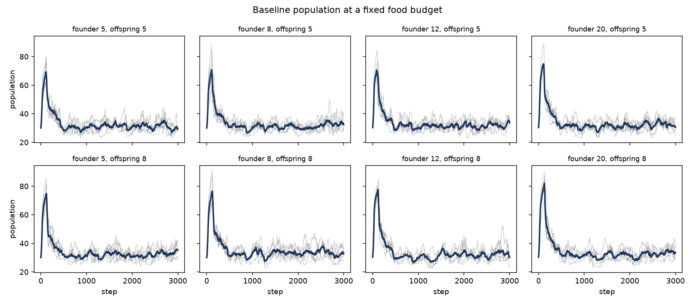

The full-length cooperation pilot booms and busts in every arm. Peaks sit
near 70 around step 100, and the endings do not: about 33 in the baseline
and higher once cooperation is on. The cap of 300 never binds, and almost
every death is starvation. The open question was whether that early boom
leaves a mark once the food budget is held still, or whether the surplus is
bled off and the ending is just the ongoing food supply.

**Headline:** the surplus is bled off. With 60 resource nodes, medium
selection pressure, and a cap of 300, the late-window population sits
between 31.0 and 33.4 agents in every cell of an 8-by-6 grid. The
within-budget slope of that late mean on overshoot has a 95% interval that
covers zero at both offspring endowments. Raising offspring from 5 resources
to the reproduction threshold of 8 does not move the late headcount by a
margin the pre-registered rule will count.

Pre-registration:
[#1040](https://github.com/Dooders/AgentFarm/issues/1040).
Tables:
[`experiments/initial_conditions_terminal/aggregate/summary.md`](../../../experiments/initial_conditions_terminal/aggregate/summary.md).

## What ran

Baseline arm only of the intrinsic-cooperation world, so the pilot figure
and the cooperation treatment stay out of the comparison. Pinned: 60
resource nodes, `selection_pressure` medium, population cap 300, 3,000
steps, `policy_temperature` 0.1, platform genes frozen, pilot mutation
defaults. Crossed:

| Factor | Levels |
| --- | --- |
| Founder `initial_agent_resource_level` | 5, 8, 12, 20 |
| `offspring_initial_resources` | 5, 8 |

Six seeds, `42, 7, 19, 101, 137, 256`. Forty-eight runs. The reproduction
threshold is 8, so founder levels straddle it and include the pilot value
of 12, and the offspring levels are the current default and the threshold
itself.

```bash
python scripts/run_initial_conditions_terminal.py \
    --output-dir experiments/initial_conditions_terminal --jobs 2
python scripts/analyze_initial_conditions_terminal.py \
    --sweep-dir experiments/initial_conditions_terminal
```

The late window is the last quarter of the run. Overshoot is peak
population minus that mean. A directional claim counts only when its 95%
Student-t interval excludes zero and the sign agrees in at least 5 of 6
seeds. The slope is ordinary least squares pooled across founder levels
within each offspring level, one point per (founder, seed).



Every panel is the same shape. The population climbs to a peak between step
89 and 143, then settles near 30 for the rest of the run. The highest peak
in the 48 runs is 91. The cap of 300 never binds. Of 10,043 deaths, 10,017
are starvation and 26 are combat.

The pilot cell is founder 12, offspring 5. Its mean peak is 72.7 at step
110, its late mean is 31.5, and its final population is 33.8. That is the
pilot's baseline (peak near 70 around step 100, ending near 33) on six
seeds instead of two.

## H0 — the boom is transient

H0 said that at a fixed food budget the founder endowment can change the
peak and the overshoot, and the late-window mean stays put. The
pre-registered test is the slope of late-window mean on overshoot.

| Offspring | Slope | 95% CI | Covers zero | Seeds with that sign |
| ---: | ---: | --- | --- | ---: |
| 5 | −0.008 | [−0.105, 0.090] | yes | 5/6 |
| 8 | −0.084 | [−0.224, 0.056] | yes | 5/6 |

Both intervals cover zero, so H0 stands. Five of six seeds slope slightly
down — a taller overshoot alongside a slightly lower ending — and that lean
is inside the noise. An extra agent of overshoot is associated with a
fraction of an agent in the late window, in either direction the interval
allows.

The cell means say the same thing without a regression. Late-window means:

| Founder | Offspring 5 | Offspring 8 |
| ---: | --- | --- |
| 5 | 31.0 [29.6, 32.5] | 32.7 [31.2, 34.1] |
| 8 | 32.2 [29.8, 34.7] | 33.4 [31.1, 35.8] |
| 12 | 31.5 [30.3, 32.8] | 32.2 [29.3, 35.1] |
| 20 | 32.7 [31.3, 34.1] | 33.1 [30.4, 35.8] |

The eight means span 2.4 agents. Several within-cell intervals are wider
than that span. Peaks sit higher, from 71.0 (founder 5, offspring 5) to
83.3 (founder 20, offspring 8), so the boom is real in every cell. Its
height, inside the range this grid produced, does not carry into the last
quarter.

Founders that start at 5, below the threshold, still boom. They gather.
The founder endowment is a head start, and the head start is gone by the
time the late window opens.

## H1 — offspring at the threshold

H1 said that giving offspring 8 resources, the amount required to
reproduce, lets the pulse continue past the founders. Late-window
population, lifespan, and `max_generation` were the three paired contrasts,
offspring 8 minus offspring 5, at each founder level. The late-window
contrast is the one H1 needs.

| Founder | Late-window difference | 95% CI | Sign |
| ---: | ---: | --- | --- |
| 5 | +1.64 | [−0.08, 3.35] | 6/6 positive |
| 8 | +1.20 | [−1.57, 3.97] | 4/6 positive |
| 12 | +0.64 | [−3.22, 4.50] | 3/6 positive |
| 20 | +0.42 | [−2.90, 3.74] | 3/6 positive |

Every interval covers zero. The poorest founders are the closest: all six
seeds at founder 5 end higher when offspring start at 8, and the interval
still includes zero. At the pilot founder level and at 20 the seeds split
evenly. H1's prediction for the ending population does not count at any
founder level.

Lifespan and generation were allowed to move even if the headcount did not.
Lifespan differences are positive at every founder level (+22, +14, +29,
+39 steps). One of them counts. At founder 20 the difference is +39.1
steps [3.6, 74.7], positive in all six seeds. The other three lifespan
intervals cover zero, including founder 8, where five of six seeds are
positive and the interval still includes zero.

`max_generation` stays in the pilot's shallow range, 2 to 4. Offspring at
8 is never a shorter lineage than offspring at 5. The only interval that
excludes zero is founder 12, +0.67 generations [0.12, 1.21]. There,
offspring 8 reaches generation 3 in every seed, and offspring 5 reaches 3
in two seeds and 2 in four. That is four seeds with a positive difference
and two with a tie. The sign rule asks for five of six, so the claim does
not count. Meeting the threshold at birth adds at most a generation or
two, in some seeds, and the food supply stops the line there.

## The buffer moved the food; this grid did not

The [resource-buffer comparison](2026-05-04-resource-buffer-shapes-intrinsic-evolution.md)
and its [six-seed check](2026-05-12-seed-sweep-reality-check.md) moved
founder resources, node count, and regeneration together. Mean population
on that axis was 84 / 96 / 108 and scaled with the food budget. The height
of the single-seed spike did not. This grid holds the food still and moves
only the startup. The late mean stays inside 31–33 while founder resources
quadruple and offspring resources cross the reproduction threshold. The
population gradient in the buffer experiment was the food. The boom, once
the food is pinned, is bled off.
