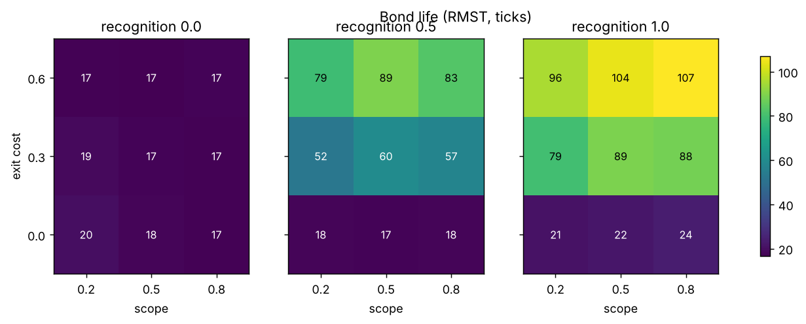
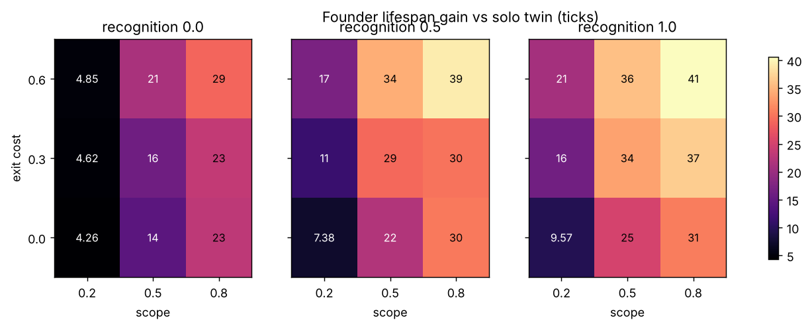
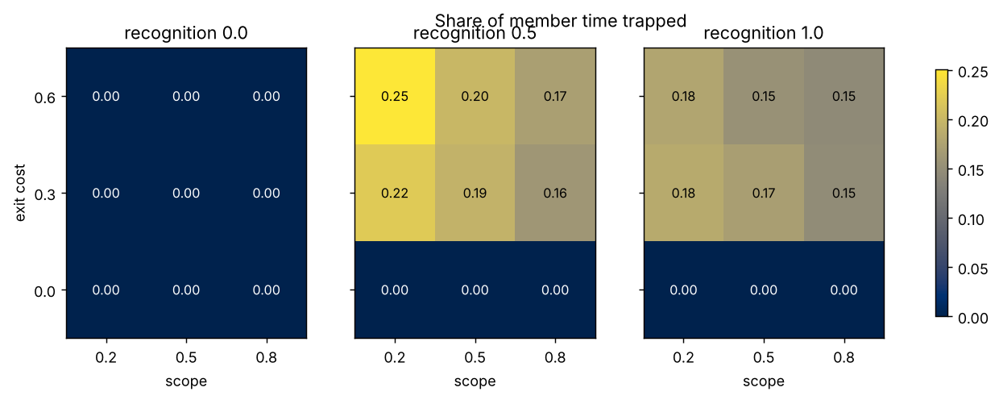
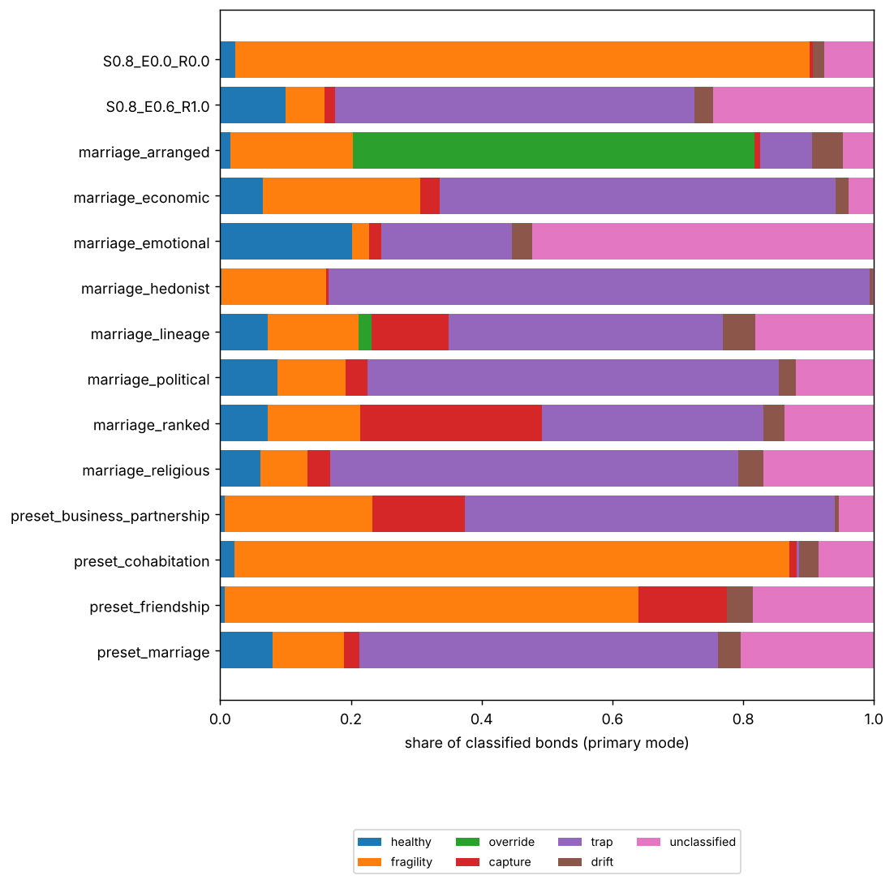
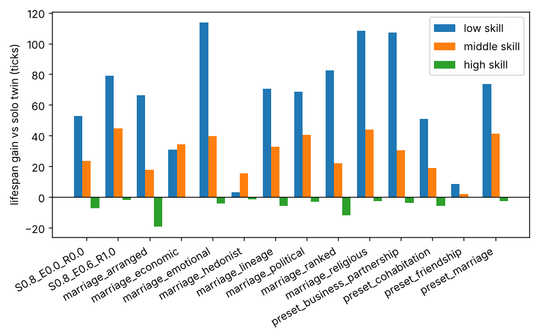

# Cooperation experiment: report

Generated 2026-10-17 02:48 UTC from 780 cooperative runs and 20 solo twins (seeds 101-120; commit 7649080318d95d48ad417d12bd34986488f6ce88).

## Confirmatory tests

| Test | Statement | Mean diff [95% CI] | Seeds > 0 | p | p (Holm) | Result |
| --- | --- | --- | --- | --- | --- | --- |
| H1 | With full recognition, a higher exit cost (0.6 vs 0) lengthens bond life. | 79.957 [77.486, 82.643] | 20/20 | <0.001 | <0.001 | significant |
| H2 | Broad scope needs a high exit cost: the scope penalty on bond life at exit cost 0 shrinks at exit cost 0.6 (full recognition). | 8.678 [5.693, 11.773] | 19/20 | <0.001 | <0.001 | significant |
| H3 | With no exit cost, full recognition still lengthens bond life (by blocking outside offers). | 4.021 [3.482, 4.603] | 20/20 | <0.001 | <0.001 | significant |
| H4a | Founder welfare is higher at a moderate exit cost (0.3) than at none (full recognition). | 7.107 [5.054, 9.173] | 19/20 | <0.001 | <0.001 | significant |
| H4b | Founder welfare is higher at a moderate exit cost (0.3) than at a high one (0.6) (full recognition). | -3.527 [-5.807, -1.151] | 3/20 | 0.995 | 1.000 | not significant |
| H5 | Trapped time rises with exit cost (0.6 vs 0.3, full recognition). | -0.008 [-0.011, -0.004] | 4/20 | 1.000 | 1.000 | not significant |

Verdicts: H1 supported, H2 supported, H3 supported, H5 not supported, H4 not supported

## Manipulation checks

| Test | Statement | Mean diff [95% CI] | Seeds > 0 | p | p (Holm) | Result |
| --- | --- | --- | --- | --- | --- | --- |
| M1 | Unrecognised exit cost is inert: bond life at exit cost 0.6 vs 0 with no recognition (two-sided). | -1.207 [-1.693, -0.696] | 2/20 | <0.001 | n/a | n/a |
| M2 | No exit payment, no trap: trap rate with exit cost 0 is zero at every recognition level (two-sided). | 0.000 [0.000, 0.000] | 0/20 | 1.000 | n/a | n/a |

## Primary grid

| Cell | RMST | Coverage | Welfare gain | Better | Worse | Trap rate | Healthy | Fragility | Trap |
| --- | --- | --- | --- | --- | --- | --- | --- | --- | --- |
| S0.2_E0.0_R0.0 | 19.9 | 0.19 | 4.3 | 0.25 | 0.18 | 0.000 | 0.03 | 0.81 | 0.00 |
| S0.5_E0.0_R0.0 | 17.9 | 0.29 | 14.4 | 0.37 | 0.15 | 0.000 | 0.02 | 0.86 | 0.00 |
| S0.8_E0.0_R0.0 | 16.9 | 0.38 | 23.0 | 0.40 | 0.16 | 0.000 | 0.02 | 0.88 | 0.00 |
| S0.2_E0.3_R0.0 | 18.7 | 0.20 | 4.6 | 0.26 | 0.19 | 0.000 | 0.03 | 0.83 | 0.00 |
| S0.5_E0.3_R0.0 | 17.4 | 0.32 | 16.3 | 0.37 | 0.16 | 0.000 | 0.02 | 0.87 | 0.00 |
| S0.8_E0.3_R0.0 | 17.1 | 0.41 | 23.4 | 0.41 | 0.16 | 0.000 | 0.02 | 0.87 | 0.00 |
| S0.2_E0.6_R0.0 | 17.0 | 0.23 | 4.8 | 0.26 | 0.19 | 0.000 | 0.02 | 0.86 | 0.00 |
| S0.5_E0.6_R0.0 | 16.5 | 0.36 | 21.4 | 0.40 | 0.15 | 0.000 | 0.01 | 0.88 | 0.00 |
| S0.8_E0.6_R0.0 | 17.5 | 0.45 | 28.8 | 0.44 | 0.14 | 0.000 | 0.02 | 0.86 | 0.00 |
| S0.2_E0.0_R0.5 | 17.8 | 0.26 | 7.4 | 0.32 | 0.17 | 0.000 | 0.02 | 0.85 | 0.00 |
| S0.5_E0.0_R0.5 | 17.5 | 0.37 | 22.1 | 0.43 | 0.14 | 0.000 | 0.02 | 0.87 | 0.00 |
| S0.8_E0.0_R0.5 | 17.7 | 0.46 | 30.4 | 0.44 | 0.15 | 0.000 | 0.02 | 0.86 | 0.00 |
| S0.2_E0.3_R0.5 | 52.3 | 0.39 | 11.4 | 0.30 | 0.19 | 0.221 | 0.03 | 0.41 | 0.31 |
| S0.5_E0.3_R0.5 | 60.0 | 0.53 | 29.2 | 0.41 | 0.15 | 0.194 | 0.03 | 0.41 | 0.34 |
| S0.8_E0.3_R0.5 | 57.2 | 0.59 | 30.0 | 0.44 | 0.14 | 0.161 | 0.06 | 0.43 | 0.32 |
| S0.2_E0.6_R0.5 | 79.0 | 0.46 | 17.3 | 0.35 | 0.14 | 0.251 | 0.04 | 0.19 | 0.51 |
| S0.5_E0.6_R0.5 | 89.4 | 0.60 | 34.4 | 0.42 | 0.13 | 0.200 | 0.05 | 0.20 | 0.52 |
| S0.8_E0.6_R0.5 | 82.9 | 0.65 | 39.2 | 0.46 | 0.12 | 0.172 | 0.07 | 0.22 | 0.47 |
| S0.2_E0.0_R1.0 | 20.9 | 0.36 | 9.6 | 0.32 | 0.19 | 0.000 | 0.03 | 0.76 | 0.00 |
| S0.5_E0.0_R1.0 | 22.1 | 0.46 | 25.2 | 0.44 | 0.14 | 0.000 | 0.04 | 0.77 | 0.00 |
| S0.8_E0.0_R1.0 | 23.7 | 0.54 | 30.7 | 0.46 | 0.15 | 0.000 | 0.05 | 0.74 | 0.00 |
| S0.2_E0.3_R1.0 | 79.5 | 0.48 | 16.3 | 0.36 | 0.14 | 0.184 | 0.06 | 0.15 | 0.48 |
| S0.5_E0.3_R1.0 | 89.1 | 0.61 | 33.6 | 0.43 | 0.13 | 0.170 | 0.06 | 0.17 | 0.50 |
| S0.8_E0.3_R1.0 | 88.1 | 0.67 | 36.9 | 0.46 | 0.13 | 0.147 | 0.09 | 0.18 | 0.47 |
| S0.2_E0.6_R1.0 | 95.6 | 0.52 | 20.9 | 0.38 | 0.14 | 0.179 | 0.06 | 0.05 | 0.58 |
| S0.5_E0.6_R1.0 | 104.0 | 0.63 | 35.8 | 0.43 | 0.14 | 0.154 | 0.07 | 0.06 | 0.57 |
| S0.8_E0.6_R1.0 | 107.0 | 0.70 | 40.6 | 0.48 | 0.10 | 0.146 | 0.10 | 0.06 | 0.55 |

## Presets, structure and motives

| Condition | RMST | Coverage | Welfare gain | Starved (coop / solo) | Trap rate | Healthy | Override | Capture | Drift |
| --- | --- | --- | --- | --- | --- | --- | --- | --- | --- |
| marriage_arranged | 76.3 | 0.75 | 21.7 | 0.58 / 0.60 | 0.145 | 0.02 | 0.61 | 0.01 | 0.05 |
| marriage_economic | 98.7 | 0.63 | 21.6 | 0.51 / 0.60 | 0.195 | 0.07 | 0.00 | 0.03 | 0.02 |
| marriage_emotional | 105.4 | 0.79 | 49.8 | 0.40 / 0.60 | 0.054 | 0.20 | 0.00 | 0.02 | 0.03 |
| marriage_hedonist | 123.1 | 0.30 | 5.9 | 0.56 / 0.60 | 0.427 | 0.00 | 0.00 | 0.00 | 0.01 |
| marriage_lineage | 97.6 | 0.69 | 32.5 | 0.49 / 0.60 | 0.141 | 0.07 | 0.02 | 0.12 | 0.05 |
| marriage_political | 98.7 | 0.73 | 35.2 | 0.47 / 0.60 | 0.160 | 0.09 | 0.00 | 0.03 | 0.03 |
| marriage_ranked | 81.6 | 0.65 | 30.9 | 0.52 / 0.60 | 0.142 | 0.07 | 0.00 | 0.28 | 0.03 |
| marriage_religious | 101.8 | 0.77 | 49.9 | 0.39 / 0.60 | 0.179 | 0.06 | 0.00 | 0.04 | 0.04 |
| preset_business_partnership | 108.9 | 0.62 | 44.6 | 0.43 / 0.60 | 0.302 | 0.01 | 0.00 | 0.14 | 0.01 |
| preset_cohabitation | 19.4 | 0.37 | 21.5 | 0.55 / 0.60 | 0.021 | 0.02 | 0.00 | 0.01 | 0.03 |
| preset_friendship | 31.7 | 0.16 | 3.3 | 0.60 / 0.60 | 0.000 | 0.01 | 0.00 | 0.13 | 0.04 |
| preset_marriage | 98.9 | 0.67 | 37.5 | 0.44 / 0.60 | 0.158 | 0.08 | 0.00 | 0.02 | 0.03 |

## Who benefits

Lifespan gain against the solo twin by founder skill tercile.

